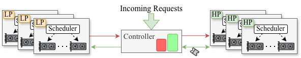
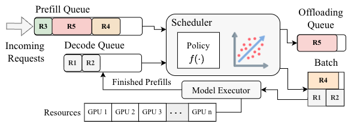
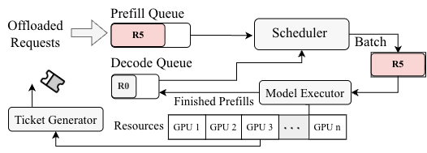

# PaceServe

> 🎉 **PaceServe has been accepted to Middleware 2026!**

[](https://arxiv.org/abs/2504.20828)

[Overview](#how-pace-works) · [Setup](#environment-and-hardware) ·
[Quick start](#run-one-experiment) · [Experiments](experiments/README.md) ·
[Repository map](#repository-map)

PaceServe is an LLM serving system that dynamically prioritizes requests to meet time-to-first-token (TTFT) and time-between-token (TBT) service-level objectives (SLOs). This repository contains the serving engine, Ray-based instance coordination, execution-time estimator, benchmark workloads. The Python package is named `paceserve`; the linked paper is titled [Ascendra: Dynamic Request Prioritization for Efficient LLM Serving](https://arxiv.org/abs/2504.20828).

## How PACE works

The default PACE configuration runs two low-priority instances and one high-priority instance, with one GPU per instance.

<p align="center">
  <a href="assets/system.png">
    
  </a>
</p>

*System overview. The controller routes incoming requests and coordinates
promotion from low-priority (LP) to high-priority (HP) instances. The figure
shows the general architecture; instance counts depend on the experiment.*

1. **Estimate execution time.** A model uses batch compute and memory
   estimates plus pretrained regression weights for prefill, decode, and
   mixed batches.
2. **Schedule low-priority batches.** Low-priority instances keep decoding
   requests moving and choose waiting prefill requests using the configured
   value function and resource limits.
3. **Promote urgent requests.** The low-priority scheduler combines waiting
   time and estimated execution time to identify requests at risk of missing
   their TTFT deadline. The controller transfers these waiting requests to
   high-priority instances. It can also send new requests directly to a
   high-priority instance when that instance advertises capacity.

### Low-priority scheduling

Low-priority instances combine ongoing decode work with selected prefill
requests. The scheduling policy and execution-time estimator guide batch
selection, while requests approaching their TTFT deadline are promoted to
the high-priority pool.

<p align="center">
  <a href="assets/lp.png">
    
  </a>
</p>

*Low-priority instance. The example shows R1–R2 continuing execution, R4
joining the batch, and R5 being promoted.*

Code: [low-priority scheduler](paceserve/core/scheduler/low_priority_scheduler.py),
[execution-time estimator](paceserve/ai_utils/ai_helper.py), and
[batch selection solvers](paceserve/ai_utils/solver.py).

### High-priority scheduling

High-priority instances prioritize urgent requests received from the
low-priority pool. A ticket mechanism also advertises available capacity to
the controller so it can dispatch new requests directly to these instances.

<p align="center">
  <a href="assets/hp.png">
    
  </a>
</p>

*High-priority instance. Promoted requests receive urgent service, while
capacity tickets allow the controller to use spare resources.*

Code: [high-priority scheduler](paceserve/core/scheduler/high_priority_scheduler.py),
[high-priority instance and tickets](paceserve/disutil/hp_instance.py), and
[request controller](paceserve/core/controller/pace_controller.py).

## Environment and hardware

- Use **Python 3.12** for the pinned runtime dependencies in
  [requirements.txt](requirements.txt). The Python 3.10 environment in
  `environment-dev.yml` is used by the lint workflow.
- Building the package requires a CUDA toolkit with `nvcc`, a C++17 compiler,
  and Ninja. Set `CUDA_HOME` if the toolkit is not discovered automatically.
  The pinned runtime uses PyTorch 2.3.0 and a FlashInfer build for CUDA 12.1 /
  PyTorch 2.3; use a compatible CUDA toolchain.
- The main experiments use **three A100 GPUs with 80 GB each**. GPU partition
  experiments use two or three GPUs; analytical model verification uses one
  A100 with at least 40 GB. The estimator and scheduling resource model use
  A100-specific constants and supplied regression weights.
- Allocate sufficient CPU resources for the Ray actors as well as GPUs. The
  main configuration defaults to 24 CPUs per instance, with additional
  actors for coordination and model workers. The count is configurable through
  `--instance_config_num_cpus_per_instance`.

Run the following from the repository root to create the environment and
compile the CUDA extensions:

```bash
conda create -p "$(pwd)/middleware-env" python=3.12 pip
conda activate "$(pwd)/middleware-env"
conda env config vars set PYTHONNOUSERSITE=1
export PYTHONNOUSERSITE=1
conda install ninja

python -m pip install -e . --extra-index-url https://flashinfer.ai/whl/cu121/torch2.3/
python -m pip check
python -c "import paceserve, flashinfer, ray; print('Runtime imports OK')"
```

The editable install loads dependencies from `requirements.txt` and builds
the extensions in [csrc/](csrc). `PYTHONNOUSERSITE=1` keeps packages in
`~/.local` out of this environment.

For each new terminal session, from the repository root:

```bash
conda activate "$(pwd)/middleware-env"
export PYTHONNOUSERSITE=1
export HF_HOME="$(pwd)/downloaded_model"
```

Set `HF_TOKEN` to your Hugging Face access token and obtain access to gated
models before running the benchmarks. The current main configuration enables:

| Model | Hugging Face repository | Local model directory |
| --- | --- | --- |
| LLaMA 3.1 8B Instruct | `meta-llama/Meta-Llama-3.1-8B-Instruct` | `downloaded_model/Llama-3.1-8B-Instruct` |
| Mistral 7B Instruct v0.2 | `mistralai/Mistral-7B-Instruct-v0.2` | `downloaded_model/Mistral-7B-Instruct-v0.2` |

The runner attempts to download a configured model if its local `config.json`
is missing. `HF_HOME` controls the Hugging Face cache; changing it does not
change the explicit model paths in
[main_config.py](experiments/main_config.py) and
[trace_replay_config.py](experiments/trace_replay_config.py).

For GPUs spread across nodes, use the same environment and make the repository,
model files, datasets, and regression weights accessible at the configured
paths on every node. Follow [the Ray cluster setup instructions](experiments/ray_setup.txt),
substituting your head node's address. The benchmark launcher initializes Ray
itself for a local run.

## Run one experiment

Run all commands below from the repository root with the environment above
active. First preview **one PACE run at 18 requests/second**:

```bash
python experiments/run.py \
  --config main_config \
  --exp_id llama_sharegpt_qps \
  --filter scheduler=PACE qps=18 \
  --dry-run
```

`--dry-run` prints the benchmark command without downloading models or starting
GPU work. To execute that configuration and reuse a matching completed run:

```bash
python experiments/run.py \
  --config main_config \
  --exp_id llama_sharegpt_qps \
  --filter scheduler=PACE qps=18 \
  --resume
```

Experiment IDs in `main_config` follow
`{llama,mistral}_{sharegpt,longbench}_{qps,slo}`. QPS sweeps vary request rate;
SLO sweeps vary a scale factor applied to both TTFT and TBT targets. The
scheduler choices are `PACE`, `VLLM`, and `SARATHI`. Omit `--filter` to run the
whole selected suite, or use filters such as
`--filter scheduler=PACE "qps>=21"`. Quote filters containing shell comparison
operators.

Qwen workload parameters and regression weights are present, but Qwen is not
enabled in `main_config.MODEL_PATHS`. The goodput wrapper still lists Qwen
experiment IDs; those currently print a “not found” message.

## Reproduce experiments and generate figures

See [the experiment guide](experiments/README.md) for commands, configuration
details, resuming runs, and plotting results.

| Experiment | Entry script | Result directory |
| --- | --- | --- |
| Execution-time model verification (Figure 5) | `bash experiments/analytical_model_verify.sh` | `analytical_model_veirification/` |
| Goodput / SLO sweeps (Figure 8) | `bash experiments/goodput_experiments.sh` | `exp_result/main_data/` |
| GPU partitions (Figure 13) | `bash experiments/gpu_partition_experiments.sh` | `exp_result/micro_data/{two_gpus,2H1L}/` |
| Admission control (Figure 14) | `bash experiments/admission_control_experiments.sh` | `exp_result/admission_control_data/` |
| Real trace replay (Figure 15) | `bash experiments/trace_experiments.sh` | `exp_result/trace_replay_data/` |

The analytical verification directory is spelled `veirification` in the code.
The trace wrapper currently runs the coding trace; the conversational trace
is available through `trace_replay_config`.

For main goodput figures, select result sessions and plot them:

```bash
python experiments/generate_goodput_plot_config.py exp_result/main_data
python experiments/goodput_plot_combined.py
```

This writes `exp_result/figures/main_data/goodput_combined.pdf`. The generated
plot configuration selects the latest session for each experiment; inspect it
before plotting incomplete sweeps. Use `--merge-sessions` on the generator to
combine sessions, with newer points overriding older ones.

Each benchmark run is stored under
`<result directory>/<experiment ID>/<timestamp>/<scheduler>/<grid parameters>/`.
Look for `execution.log`, `meta.json`, `config.yaml`, and metrics such as
`replica_0/sequence_metrics.csv` and `replica_0/batch_metrics.csv`.
`SUCCESS.txt` marks a successful run; `FAILED_CRASH.txt` and
`FAILED_TIMEOUT.txt` mark exhausted retries. Inspect these files when checking
completion: a suite finishing does not mean every run succeeded.

## Citation

```bibtex
@article{ikram2025ascendra,
  title={Ascendra: Dynamic request prioritization for efficient llm serving},
  author={Ikram, Azam and Li, Xiang and Elnikety, Sameh and Bagchi, Saurabh},
  journal={arXiv preprint arXiv:2504.20828},
  year={2025}
}
```
