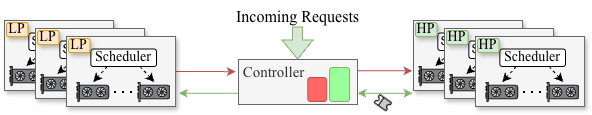

# Middleware replication

<p align="center">
  <a href="../README.md#how-pace-works">
    
  </a>
</p>

The experiments evaluate the system above across workloads, SLO targets, and
GPU partitions. See the [architecture and scheduler figures](../README.md#how-pace-works)
for an explanation of the low- and high-priority instances.

Run commands from the repository root. Follow the
[environment and hardware setup](../README.md#environment-and-hardware) first,
activate the benchmark environment, and set `HF_TOKEN` and `HF_HOME`. For
multiple GPU nodes, form a [Ray cluster](ray_setup.txt) using your head node's
address and make all configured input paths accessible on every node.

The runtime dependency snapshot uses Python 3.12, PyTorch 2.3.0, and FlashInfer
for CUDA 12.1 / PyTorch 2.3. A compatible CUDA toolkit with `nvcc` is required
to build the package. See [the main README](../README.md) for installation.

## Runner and configurations

[run.py](run.py) expands a configuration's parameter grid into benchmark
commands that invoke `paceserve/benchmark/main.py`. Preview a single run:

```bash
python experiments/run.py \
  --config main_config \
  --exp_id llama_sharegpt_qps \
  --filter scheduler=PACE qps=18 \
  --dry-run
```

Remove `--dry-run` to execute it. Add `--resume` to reuse results with matching
benchmark arguments, ignoring their output directory. Failed or incomplete
runs are retried; changed arguments trigger a new run. Resuming uses the latest
session directory and can copy matching completed runs from earlier sessions.
Replaced attempts are preserved under `.previous_attempts/` outside the result
sessions used for plotting.

Each run gets at most two attempts. Per-run timeouts are set by the selected
configuration. Check `execution.log` and `SUCCESS.txt` or `FAILED_*.txt` in the
run directory to determine whether a run completed successfully.

| Configuration | Workload / layout | Result root | Per-run timeout |
| --- | --- | --- | --- |
| [main_config](main_config.py) | LLaMA and Mistral; ShareGPT and LongBench; three GPUs | `exp_result/main_data` | 30 minutes |
| [single_gpu_config](single_gpu_config.py) | LLaMA/ShareGPT; vLLM and Sarathi; one GPU | `analytical_model_veirification` | 10 minutes |
| [two_gpus_config](two_gpus_config.py) | Two GPUs; PACE uses one low- and one high-priority instance | `exp_result/micro_data/two_gpus` | 30 minutes |
| [two_h_one_l_config](two_h_one_l_config.py) | Three GPUs; PACE uses one low- and two high-priority instances | `exp_result/micro_data/2H1L` | 30 minutes |
| [experiments.admission_control_config](admission_control_config.py) | LLaMA/ShareGPT; dropping enabled; three GPUs | `exp_result/admission_control_data` | 20 minutes |
| [trace_replay_config](trace_replay_config.py) | LLaMA with recorded arrival times; three GPUs | `exp_result/trace_replay_data` | 90 minutes |

Main experiment IDs follow `{llama,mistral}_{sharegpt,longbench}_{qps,slo}`.
Use `scheduler`, `qps`, or `slo_scale` filters as appropriate for the grid:

```bash
python experiments/run.py \
  --config main_config \
  --exp_id mistral_longbench_slo \
  --filter scheduler=SARATHI "slo_scale>=1.0" \
  --dry-run
```

Qwen settings and regression weights remain in the repository, but Qwen is
absent from `main_config.MODEL_PATHS` and `HF_REPO_IDS`. The goodput wrapper
still calls Qwen IDs, which currently print “not found”. To enable Qwen, add
its model path and download mapping and update the plotting layout as needed.

## Batch execution-time model verification (Figure 5)

Hardware: one A100 GPU with at least 40 GB memory.

```bash
bash experiments/analytical_model_verify.sh
```

The script runs the LLaMA/ShareGPT QPS sweep with vLLM and Sarathi, using
pretrained weights from `paceserve/ai_utils/regression_weights/llama`, then
invokes `plotting_tools/plot_analytical_model.py`. It compares measured and
estimated batch execution times for pure prefill and mixed batches.

Results and logs are under `analytical_model_veirification/`; the figure is
`analytical_model_veirification/plots/estimation_scatter_all_qps.png`. The
directory spelling matches the configuration and plotting code.

To preview the benchmark without invoking the wrapper's plotting step:

```bash
python experiments/run.py \
  --config single_gpu_config \
  --exp_id llama_sharegpt_qps \
  --dry-run
```

## Goodput comparison (Figure 8)

Hardware: three A100 GPUs with 80 GB memory each. PACE uses two low-priority
instances and one high-priority instance. vLLM and Sarathi each use three
mixed instances with round-robin dispatch.

```bash
bash experiments/goodput_experiments.sh --dry-run
bash experiments/goodput_experiments.sh
```

The wrapper enables `--resume` and runs the configured model/dataset QPS and
SLO sweeps. Workloads use request lengths from
`distserve_dataset/sharegpt_distserve.csv` and
`distserve_dataset/long_bench_filtered.csv`, with Poisson arrival intervals.
The main defaults generate 2,000 requests and set `--time_limit 600`; change
workloads and SLO targets in [main_config.py](main_config.py).

Results go to `exp_result/main_data/<experiment ID>/<timestamp>/`; wrapper
logs go to `logs/main_config/`.

Generate the plotting configuration and combined figure:

```bash
python experiments/generate_goodput_plot_config.py exp_result/main_data
python experiments/goodput_plot_combined.py
```

The generator writes `experiments/goodput_plot_config.json`, selecting the
latest timestamped session for each QPS/SLO experiment. Session selection does
not verify run completion. Review the selected sessions before using a figure
as a completed result.

To combine runs spread across multiple sessions:

```bash
python experiments/generate_goodput_plot_config.py \
  exp_result/main_data --merge-sessions
python experiments/goodput_plot_combined.py
```

Newer session points override older ones. The generator preserves any existing
`static_data` and `baselines` entries, so review those too when selecting fresh
results. The current figure layout includes LLaMA and Mistral on both datasets.
It writes `exp_result/figures/main_data/goodput_combined.pdf` and reports SLO
attainment using both TTFT and mean TBT thresholds.

## Admission control (Figure 14)

Hardware: three A100 GPUs with 80 GB memory each.

```bash
bash experiments/admission_control_experiments.sh --dry-run
bash experiments/admission_control_experiments.sh
```

[admission_control_config.py](admission_control_config.py) compares PACE, vLLM,
and Sarathi with request dropping enabled. Its defaults use LLaMA/ShareGPT at
24.5 requests/second for 600 seconds, with a 1.0-second TTFT target and a
0.15-second TBT target. `SCHEDULERS_TO_RUN` controls which schedulers execute.
The wrapper plots a comparison after a real run when all three are selected.

Results are stored in
`exp_result/admission_control_data/llama_sharegpt_admission/<timestamp>/`.
The session's `figures/` directory contains PNG and PDF charts, a CSV of
request counts, and JSON metadata. Wrapper logs go to
`logs/experiments.admission_control_config/`.

To plot an existing session:

```bash
python experiments/plot_admission_control.py \
  --session exp_result/admission_control_data/llama_sharegpt_admission/YYYYMMDD_HHMMSS
```

Replace `YYYYMMDD_HHMMSS` with the session timestamp. Omit `--session` to select
the latest session, or use `--output-dir` to choose the destination. The plot
shows attained, dropped, and completed SLO-violating request counts, with
ratios relative to Sarathi.

## Real trace replay (Figure 15)

Hardware: three A100 GPUs with 80 GB memory each.

```bash
bash experiments/trace_experiments.sh --dry-run
bash experiments/trace_experiments.sh
```

The wrapper currently runs `llama_code_trace` and enables `--resume`. It
replays arrival times and token counts from
`wild/code_distributions_processed.csv`. The conversational workload is also
configured; run it separately with:

```bash
python experiments/run.py \
  --config trace_replay_config \
  --exp_id llama_conv_trace \
  --resume
```

Results go to `exp_result/trace_replay_data/<experiment ID>/<timestamp>/`, with
wrapper logs under `logs/trace_replay_config/`. Failed scheduler runs restart
from the beginning rather than continuing partway through the trace. The
optional `llama_sample_trace` configuration requires `wild/sample.csv`, which
is not included in the repository.

## GPU partition experiments (Figure 13)

Hardware: two A100 GPUs for the first sweep and three for the second, each
with 80 GB memory.

```bash
bash experiments/gpu_partition_experiments.sh --dry-run
bash experiments/gpu_partition_experiments.sh
```

The script runs:

- `two_gpus_config`, `llama_sharegpt_qps`: vLLM, Sarathi, and PACE. PACE uses
  one low-priority and one high-priority instance (1H1L).
- `two_h_one_l_config`, `llama_longbench_qps`: PACE uses two high-priority
  instances and one low-priority instance (2H1L). The configuration also
  includes the baseline schedulers.

Results are under `exp_result/micro_data/two_gpus/` and
`exp_result/micro_data/2H1L/`. Logs go to `logs/two_gpus_config/` and
`logs/two_h_one_l_config/`.

The wrapper's `run_exp` helper does not forward its extra `--filter` argument
for the second sweep, so that sweep currently includes all schedulers. To run
only PACE there, invoke the runner directly:

```bash
python experiments/run.py \
  --config two_h_one_l_config \
  --exp_id llama_longbench_qps \
  --filter scheduler=PACE \
  --resume
```

## Micro experiment figures (Figures 10–13 and 15)

After collecting the relevant main, trace, and GPU partition results:

```bash
python experiments/plot_micro.py --data-dir exp_result/main_data --dry-run
python experiments/plot_micro.py --data-dir exp_result/main_data
```

The driver selects the latest timestamped sessions, prints the selected paths,
and runs timeline, transfer overhead, offload/SLO, fairness, two-GPU goodput,
and 2H1L comparison plots. Missing inputs are reported as `[SKIP]`. Inspect
the output to see which figures were generated; an incomplete sweep may not
provide all required QPS points.

Use `--trace-data-dir`, `--two-gpu-data-dir`, and `--two-h-one-l-data-dir` if
results are stored outside their default directories. Figures are written
under `exp_result/figures/` and its experiment-specific subdirectories.
